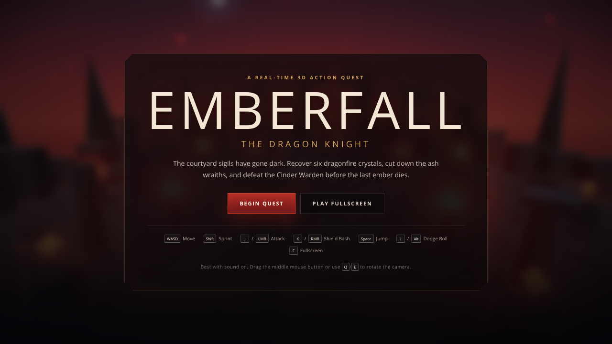
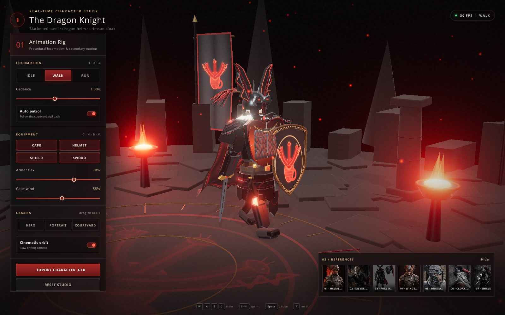

# Emberfall — The Dragon Knight

A playable, browser-based **third-person 3D action game** built around the procedural Dragon Knight from the supplied reference plates. The knight is an original parametric interpretation of their visual language: blackened etched plate, scale mail, a winged dragon-head helmet with a crimson plume, silver hair, a dragon-sigil kite shield, a longsword, and a wind-driven red cape.





## Play the quest

Recover six dragonfire sigils, survive three enemy waves, and defeat the Cinder Warden in a ruined courtyard. The game includes a third-person camera, melee combos, shield bash, dodge roll, jump, stamina and health systems, collectible objectives, enemy telegraphs, a boss health bar, combo scoring, a minimap, procedural sound, fullscreen support, and victory/defeat screens.

```bash
npm install
npm run dev
```

Then open the live preview or `http://localhost:5173`. The Vite server binds to `0.0.0.0` for the Arena preview environment.

Other commands:

```bash
npm run build          # production bundle
npm run preview        # preview the production build
npm run test:model     # validate geometry, bounds, and animation node bindings
npm run export:glb     # regenerate the standalone GLB asset
```

## Controls

| Action | Control |
| --- | --- |
| Start / resume / play again | `Enter` or the screen buttons |
| Move | `W` `A` `S` `D` / arrow keys / touch joystick |
| Sprint | `Shift` or push the joystick to its edge |
| Sword combo | `J` or left mouse button / Attack button |
| Guard + shield bash | Hold `K` or right mouse button / Shield button; press to bash |
| Jump | `Space` / Jump button |
| Dodge roll | `L`, `Alt`, or Dodge button |
| Rotate camera | Mouse look, `Q` / `E`, middle-drag, or right-side touch drag |
| Zoom camera | Mouse wheel |
| Fullscreen | `F`, the fullscreen icon, or **Play Fullscreen** |
| Sound | `M` or the sound icon |
| Pause / resume | `Esc`, `P`, or the pause icon |

Desktop starts in pointer-lock mouse look when the browser allows it. If pointer lock is blocked, `Q` / `E` and middle-drag still rotate the camera. Touch devices get a virtual joystick and four action buttons.

## What is included

- **Procedural hero** — a named, articulated hierarchy with 300+ meshes, PBR metals and leather, instanced scale mail, rivets, fur, hair strands, plume strands, shield, sword, and dynamically deforming cape cloth.
- **Playable combat** — three-stage sword combos with sword trails and slash arcs, frontal guard, shield bash stagger, dodge i-frames, jumping, stamina costs, hit reactions, floating damage numbers, and camera shake.
- **Three-wave quest** — six collectible sigils, ash wraiths, armored brutes, telegraphed enemy attacks, boss area slams, mid-fight minion summons, scoring, combo tracking, and a final victory sequence.
- **Cinematic world** — procedural sky and moon, an animated cinder rift gate, runic pylons, ground mist, rubble and cover, broken pillars, four animated braziers, waving banners, drifting embers, footfall dust, fog, and rim lighting.
- **Enhanced renderer** — PMREM environment lighting, ACES filmic tone mapping, high-quality shadows, selective bloom, FXAA, optional GTAO on High, GPU point-sprite particles, and High / Medium / Low quality presets.
- **Game HUD** — health and stamina bars, objective and wave progress, score, timer, kills, FPS, minimap, boss bar, combo and message callouts, pause / end screens, touch controls, and fullscreen controls.
- **Procedural audio** — synthesized sword swishes, impacts, blocks, sigil chimes, footsteps, boss roars, ambient wind/drone, and intensity-aware combat pulses. No external audio files.
- **Model export** — the portable `public/models/dragon-knight.glb` and `public/models/dragon-knight.info.json` remain available. The hidden `window.__DRAGON_KNIGHT__.exportCharacter()` compatibility hook can still export the rig with runtime canvas textures.

## Fullscreen and quality

Click **Play Fullscreen** on the title screen, press `F`, or use the fullscreen icon in the HUD. The app uses the browser Fullscreen API on the whole game container and automatically resizes the renderer, composer, post-processing passes, particles, and minimap viewport.

Use **Quality: High / Medium / Low** in the pause menu to trade off pixel ratio, GTAO, bloom, FXAA, and shadow-map resolution. Mobile and software-renderer environments start on a lighter preset automatically.

## Termux

A dedicated installer, shortcodes and troubleshooting notes live in [`termux/README.md`](termux/README.md). Quick start:

```bash
curl -fsSL https://github.com/eraslan19j/Tarama/raw/refs/heads/arena/2b2224d1-tarama/termux/bootstrap.sh \
  | bash -s -- DK3D-2517-TARAMA DRAGON-5173-TERMUX
```

Download code: `DK3D-2517-TARAMA`  
Activation code: `DRAGON-5173-TERMUX`

These are convenience shortcodes, not license keys. Termux and this project require no paid activation.

## Exported model

`public/models/dragon-knight.glb` is generated from the same parametric character module used by the live game. It preserves named nodes such as `Hips`, `Torso`, `LeftLeg`, `RightLeg`, `LeftPauldron`, `AnimatedCrimsonCape`, `DragonShield`, and `ValyrianLongsword`, and embeds three one-second looping clips: `Idle`, `Walk`, and `Run`. The static file is intentionally texture-free for maximum glTF viewer compatibility; the hidden in-app export includes the runtime-generated canvas textures.

`public/models/dragon-knight.info.json` records mesh, vertex, triangle, height, and clip metadata.

## Project layout

```text
index.html                         Game shell, HUD, title / pause / end screens
src/main.js                        Boot, renderer setup, hidden QA/export APIs
src/style.css                      Game HUD, screens, reticle and touch controls
src/game/game.js                   Quest state machine, waves, scoring, render loop
src/game/renderer.js               Quality presets, PMREM, GTAO, bloom, FXAA
src/game/player.js                 Movement, combat, stamina, jump, dodge, damage
src/game/playerAnimation.js        Combat / jump / dodge / death pose overlays
src/game/enemies.js                Enemy meshes, AI, waves, boss, hit queries
src/game/sigils.js                 Collectible dragonfire crystals
src/game/arena.js                  Sky, gate, pylons, mist, rubble, colliders
src/game/effects.js                Slash arcs, shockwaves, flashes, camera shake
src/game/particles.js              GPU point-sprite sparks, embers, dust, magic
src/game/audio.js                  Procedural Web Audio sound engine
src/game/camera.js                 Third-person follow / mouse-look camera
src/game/input.js                  Keyboard, mouse, pointer lock and touch input
src/game/fullscreen.js             Fullscreen API with vendor fallbacks
src/game/hud.js                    HUD updates, floating text and minimap
src/scene/materials.js             PBR material palette
src/scene/textures.js              Procedural metal, stone, sigil, cape, banner textures
src/scene/geometry.js              Plates, tubes, cloth mesh, shape utilities
src/scene/world.js                 Courtyard, ruins, braziers, banners, atmosphere
src/scene/animation.js             Locomotion, secondary motion, cape deformation
src/scene/export.js                GLTF animation clips
src/scene/character/               Body, head/helmet, equipment, rig assembly
public/references/                  Supplied visual reference plates
public/models/                     Generated GLB and metadata
scripts/                           Model validation and GLB generation
termux/                            Termux download, activation and bootstrap scripts
docs/title-screen.png              Rendered game title screen
docs/studio-preview.jpg            Original character render
```

The existing `repomind/` Python utility is untouched.

## Notes

This is a real-time procedural character and game, not photogrammetry or an exact likeness of a performer. The supplied images are design references and remain in `public/references/`. All runtime textures, effects, and sounds are generated locally with Canvas 2D, Three.js shaders, and Web Audio; there are no external runtime asset hosts or CDN dependencies.
